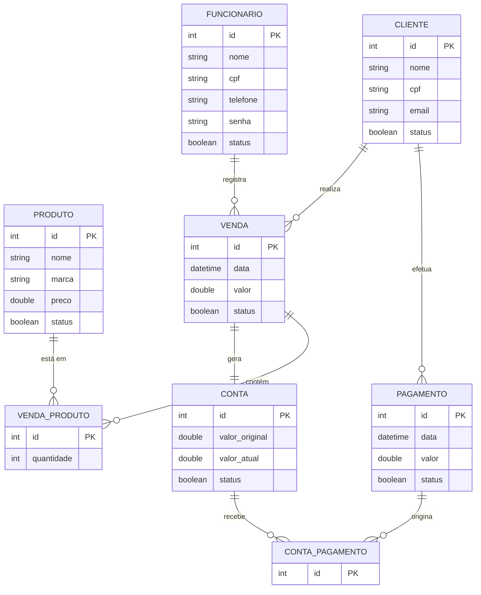

# Documento de Visão

<!-- Documento construído a partido do **Modelo BSI - Doc 001 - Documento de Visão** que pode ser encontrado no
link: https://docs.google.com/document/d/1DPBcyGHgflmz5RDsZQ2X8KVBPoEF5PdAz9BBNFyLa6A/edit?usp=sharing -->

## Descrição do Projeto

O **"Sistema de Controle de Vendas Fiadas"** foi idealizado para atender às necessidades da loja **"Ritomakar Esportes"**, que enfrenta séria desorganização no controle de vendas a prazo. Atualmente, os **registros de clientes**, **vendas** e **pagamentos** são feitos *manualmente em papéis e cadernos*, sem **padronização**, gerando **lentidão no atendimento**, **risco de perda de dados** e **dificuldade para identificar débitos em aberto** e clientes inadimplentes. 

A solução consiste em uma aplicação desktop que **automatiza** o controle financeiro de vendas fiadas. O sistema oferece **cadastro padronizado de clientes e produtos**, **registro de vendas e pagamentos**, **consulta rápida de saldo e contas pendentes**, **controle de limite de crédito**,**prioridade automática de débitos** (priorizando as contas mais antigas), **envio de notificações de inadimplência** e **emissão de relatórios** de clientes em atraso.

## Equipe e Definição de Papéis

|            Membro             |     Papel     |                 E-mail               | 
| :---------------------------- | :-----------: | :----------------------------------: |
| Karliane Medeiros             | Orientadora   | karliane.vale@ufrn.br                |
| Pedro Lucas da Silva Araújo   | Desenvolvedor | pedro.araujo.716@ufrn.edu.br         | 
| Thomas Reyel da Silva Morais  | Desenvolvedor | thomasreyel2231@gmail.com            | 
| Pedro Henrique da Silva       | Desenvolvedor | pedro.silva.437@ufrn.edu.br          |
| Guilherme Fernandes e Silva   | Desenvolvedor | guilhermefernandescruzeta@gmail.com  | 
| Jezreel Asaias da Silva Souza | Desenvolvedor | jezreel.asaias.silva.129@ufrn.edu.br |

### Matriz de Competências

|           Membro              |            Competências            |
| :---------------------------- | :--------------------------------: |
| Karliane Medeiros             | Gestão de Projetos, Professora     | 
| Pedro Lucas da Silva Araújo   | Estudante de sistema de informação | 
| Thomas Reyel da Silva Morais  | Estudante de sistema de informação | 
| Pedro Henrique da Silva       | Estudante de sistema de informação | 
| Guilherme Fernandes e Silva   | Estudante de sistema de informação | 
| Jezreel Asaias da Silva Souza | Estudante de sistema de informação |

## Perfis dos Usuários

O sistema poderá ser utilizado por diferentes perfis de usuários na loja **"Ritomakar Esportes"**. Temos os seguintes atores/perfis definidos:

|            Perfil           | Descrição |
| :-------------------------- | :-------: |
| **Administrador / Gerente** | *Usuário com permissões totais no sistema (dono/gerente da loja). Responsável pelo cadastro, atualização e desativação de funcionários e produtos, alteração do status de confiabilidade dos clientes, desativação de vendas e pagamentos, além da visualização de relatórios gerenciais e lista de inadimplentes.* | 
| **Funcionário / Atendente** | *Usuário operacional logado. Responsável pelo atendimento direto ao cliente, incluindo realização de vendas fiadas, cadastro e consulta de clientes, registro de pagamentos e consulta de contas e produtos.* | 
| **Cliente**                 | *Consumidor cadastrado no sistema. Não possui acesso direto à interface do software, mas é a entidade sobre a qual se mantêm os cadastros de CPF, limite de crédito inicial de R$ 200,00 (status inicial "não confiável"), histórico de compras fiadas e débitos pendentes.* |

## Lista de Requisitos Funcionais

### Entidade Funcionário - RF01 - Gerenciar Funcionário
Um funcionário tem: nome, data de nascimento, endereço, telefone, CPF e senha.

Requisito                         | Descrição | Ator |
--------------------------------- | ----------- | ---------- |
RF01.01 - Inserir Funcionário     | Insere novo funcionário informando: nome, data de nascimento, endereço, telefone, CPF e senha. | Administrador |
RF01.02 - Listar Funcionários     | Listagem de funcionários utilizando filtros nos atributos: nome, data de nascimento, endereço, telefone e CPF. | Administrador |
RF01.03 - Atualizar Funcionário   | Atualiza um funcionário informando: nome, data de nascimento, endereço, telefone, CPF e senha. | Administrador |
RF01.04 - Desativar Funcionário   | Desativa um funcionário cadastrado no sistema. | Administrador |

---

### Entidade Cliente - RF02 - Gerenciar Cliente
Um cliente tem: nome, data de nascimento, endereço, telefone e CPF.

Requisito                         | Descrição | Ator |
--------------------------------- | ----------- | ---------- |
RF02.01 - Inserir Cliente         | Insere novo cliente informando: nome, data de nascimento, endereço, telefone e CPF. | Funcionário, Cliente |
RF02.02 - Listar Clientes         | Listagem de clientes utilizando filtros nos atributos: nome, data de nascimento, endereço, telefone e CPF. | Funcionário, Cliente |
RF02.03 - Atualizar Cliente       | Atualiza um cliente informando: nome, data de nascimento, endereço, telefone e CPF. | Funcionário, Cliente |
RF02.04 - Desativar Cliente       | Desativa um cliente cadastrado no sistema. | Funcionário, Cliente |

---

### Entidade Produto - RF03 - Gerenciar Produto
Um produto tem: nome, marca e valor.

Requisito                         | Descrição | Ator |
--------------------------------- | ----------- | ---------- |
RF03.01 - Inserir Produto         | Insere novo produto informando: nome, marca e valor. | Funcionário |
RF03.02 - Listar Produtos         | Listagem de produtos utilizando filtros nos atributos: nome, marca e valor. | Funcionário |
RF03.03 - Atualizar Produto       | Atualiza um produto informando: nome, marca e valor. | Funcionário |
RF03.04 - Desativar Produto       | Desativa um produto cadastrado no sistema. | Funcionário |

---

### Entidade Pagamento - RF04 - Administrar Pagamento
Um pagamento tem: cliente, data, funcionário responsável e valor.

Requisito                         | Descrição | Ator |
--------------------------------- | ----------- | ---------- |
RF04.01 - Inserir Pagamento       | Insere novo pagamento informando: cliente, data, funcionário responsável e valor. | Funcionário |
RF04.02 - Listar Pagamentos       | Listagem de pagamentos utilizando filtros nos atributos: cliente, data, funcionário responsável e valor. | Funcionário |
RF04.03 - Desativar Pagamento     | Desativa um pagamento cadastrado no sistema. | Funcionário |

---

### Entidade Venda - RF05 - Cadastrar Venda
Uma venda tem: cliente, funcionário responsável, produto, data e valor.

Requisito                         | Descrição | Ator |
--------------------------------- | ----------- | ---------- |
RF05.01 - Inserir Venda           | Cadastra nova venda informando: cliente, funcionário responsável, produto, data e valor. | Funcionário |

---

### Entidade Venda - RF06 - Consultar Venda
Uma venda representa uma transação realizada entre um cliente e a empresa.

Requisito                         | Descrição | Ator |
--------------------------------- | ----------- | ---------- |
RF06.01 - Consultar Vendas        | Realiza a consulta das vendas realizadas no sistema. | Funcionário |

---

### Entidade Venda - RF07 - Cancelar Venda
Uma venda pode ser cancelada mediante a informação do motivo do cancelamento.

Requisito                         | Descrição | Ator |
--------------------------------- | ----------- | ---------- |
RF07.01 - Cancelar Venda          | Permite cancelar uma venda informando o motivo do cancelamento. | Administrador |

---

### Entidade Cliente - RF08 - Consultar Inadimplentes
Clientes inadimplentes são aqueles que possuem débitos pendentes.

Requisito                         | Descrição | Ator |
--------------------------------- | ----------- | ---------- |
RF08.01 - Listar Inadimplentes    | Gera uma lista contendo todos os clientes inadimplentes. | Administrador, Funcionário |

---

### Entidade Funcionário - RF09 - Realizar Login
Um funcionário realiza login no sistema utilizando uma senha única.

Requisito                         | Descrição | Ator |
--------------------------------- | ----------- | ---------- |
RF09.01 - Login do Funcionário    | Realiza login informando a senha única do funcionário. | Funcionário |

---

### Entidade Conta - RF10 - Gerar Conta
Uma conta é gerada automaticamente quando uma venda é cadastrada.

Requisito                         | Descrição | Ator |
--------------------------------- | ----------- | ---------- |
RF10.01 - Gerar Conta             | Gera automaticamente uma conta para o cliente quando uma venda é cadastrada. | Sistema |

---

### Entidade Conta - RF11 - Consultar Conta
Uma conta representa os débitos de um cliente no sistema.

Requisito                         | Descrição | Ator |
--------------------------------- | ----------- | ---------- |
RF11.01 - Consultar Conta         | Realiza a consulta da conta de um cliente. | Funcionário |

---

### Entidade Conta - RF12 - Consultar Contas
Um cliente pode possuir várias contas ativas no sistema.

Requisito                         | Descrição | Ator |
--------------------------------- | ----------- | ---------- |
RF12.01 - Consultar Contas Ativas | Permite visualizar todas as contas ativas de um determinado cliente. | Funcionário |

---

### Entidade Conta - RF13 - Pagar Conta
O pagamento de uma conta deve priorizar os débitos mais antigos do cliente, utilizando eventuais créditos para abater dívidas posteriores.

Requisito                         | Descrição | Ator |
--------------------------------- | ----------- | ---------- |
RF13.01 - Pagar Conta             | Realiza a baixa dos débitos de clientes, garantindo que o pagamento seja destinado à conta mais antiga. Caso exista troco ou crédito, o valor restante será utilizado para abater a próxima dívida pendente. | Funcionário |

---

### Entidade Conta - RF14 - Cancelar Conta
Uma conta deve ser cancelada quando a venda que a originou for cancelada.

Requisito                         | Descrição | Ator |
--------------------------------- | ----------- | ---------- |
RF14.01 - Cancelar Conta          | Cancela a conta do cliente quando a venda correspondente é cancelada. | Sistema |

---

### Modelo Conceitual

Abaixo apresentamos o modelo conceitual do sistema da **"Ritomakar Esportes"** utilizando o **Mermaid**.

#### Descrição das Entidades

## Lista de Requisitos Não-Funcionais

Requisito                                      | Descrição |
---------------------------------------------- | ----------- |
RNF001 - Permissões                            | O sistema deve ter diferentes níveis de permissões. Dessa forma, dependendo de qual funcionário está utilizando ele, o sistema bloqueia/libera funcionalidades como: alterar o status do cliente (confiável/não confiável), ou gerenciar funcionário. |
RNF002 - Design e Usabilidade da Interface     | A interface do sistema deve seguir padrões de usabilidade e consistência visual, permitindo que usuários realizem operações básicas sem necessidade de treinamento avançado. Os componentes visuais devem manter padronização de cores, menus, formulários e mensagens do sistema, garantindo clareza na navegação e facilidade de aprendizado. |
RNF003 - Notificação de Inadimplência          | No momento em que um cliente com uma dívida ativa completar 6 meses sem realizar um pagamento, o sistema deve enviar uma notificação na tela principal informando qual cliente está nessa situação. |
RNF004 - Login e Acesso                        | O sistema deve restringir funcionários que não fizeram login a somente ler os dados cadastrados no sistema. Além disso, deve permitir que apenas funcionários "logados" consigam alterar dados do sistema. |
RNF005 - Limite de Crédito                     | Clientes recém-cadastrados devem ter o status "não confiável" e possuir um limite de crédito de, no máximo, R$ 200. |
RNF006 - Bloqueio de Conta                     | Clientes com o status de "inadimplente" não podem ter novas contas cadastradas. Se uma conta tentar ser cadastrada em um cliente inadimplente, o sistema irá cancelar a operação e enviar uma notificação. |
RNF007 - Velocidade de Processamento           | O sistema deve processar operações que envolvam o banco de dados em até 3 segundos. |
RNF008 - Capacidade do Banco de Dados          | O banco de dados deve suportar o armazenamento de até 100.000 registros de vendas e clientes sem perda de performance. |
RNF009 - Estrutura de Hardware                  | O sistema não funcionará pela web, por isso necessita de um computador desktop ou notebook com pelo menos 4 GB de RAM e Windows 10 ou Linux. |

## Riscos

Tabela com o mapeamento dos riscos do projeto, as possíveis soluções e os responsáveis.

Data | Risco | Prioridade | Responsável | Status | Providência/Solução |
------ | ------ | ------ | ------ | ------ | ------ |
10/03/2018 | Não aprendizado das ferramentas utilizadas pelos componentes do grupo | Alta | Todos | Vigente | Reforçar estudos sobre as ferramentas e aulas com a integrante que conhece a ferramenta |
10/03/2018 | Ausência por qualquer motivo do cliente | Média | Gerente | Vigente | Planejar o cronograma tendo em base a agenda do cliente |
10/03/2018 | Divisão de tarefas mal sucedida | Baixa | Gerente | Vigente | Acompanhar de perto o desenvolvimento de cada membro da equipe |
10/03/2018 | Implementação de protótipo com as tecnologias | Alto | Todos | Resolvido | Encontrar tutorial com a maioria da tecnologia e implementar um caso base do sistema |

### Referências
