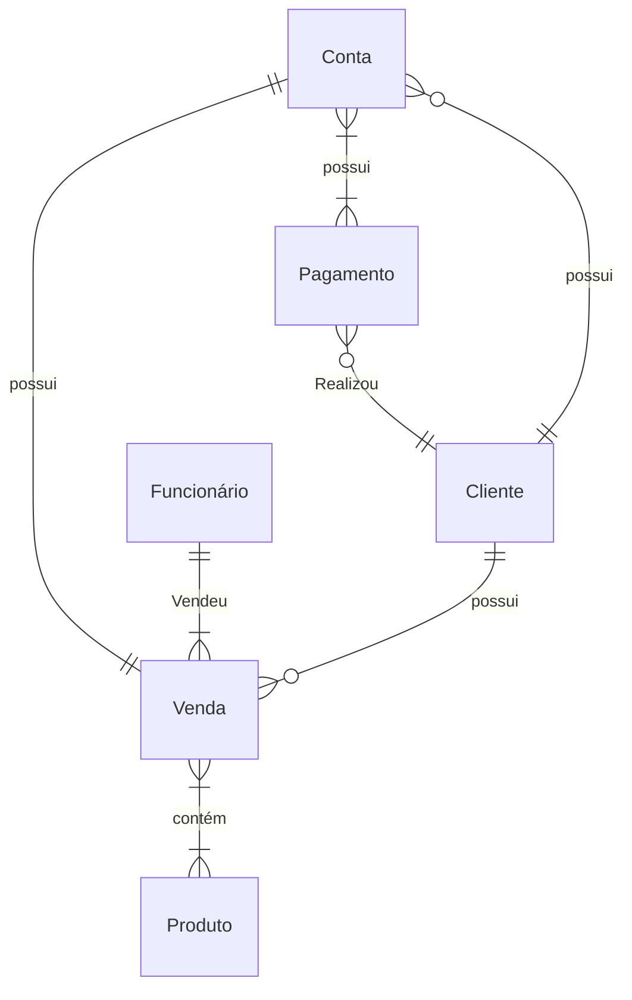

# Documento de Modelos

## Modelo Conceitual

### Diagrama de Classes usando Mermaid
...

### Descrição das Entidades

| Entidade | Descrição   |
|----------|------------------------------------------------------------------------------------------------------------------------------------------------------|
|

## Modelo de Dados (Entidade-Relacionamento)

|  Nome         | Descrição                        | Tipo de Dado | Tamanho | Restrições de Domínio |
| ------------- | -------------------------------- | ------------ | ------- | --------------------- |

