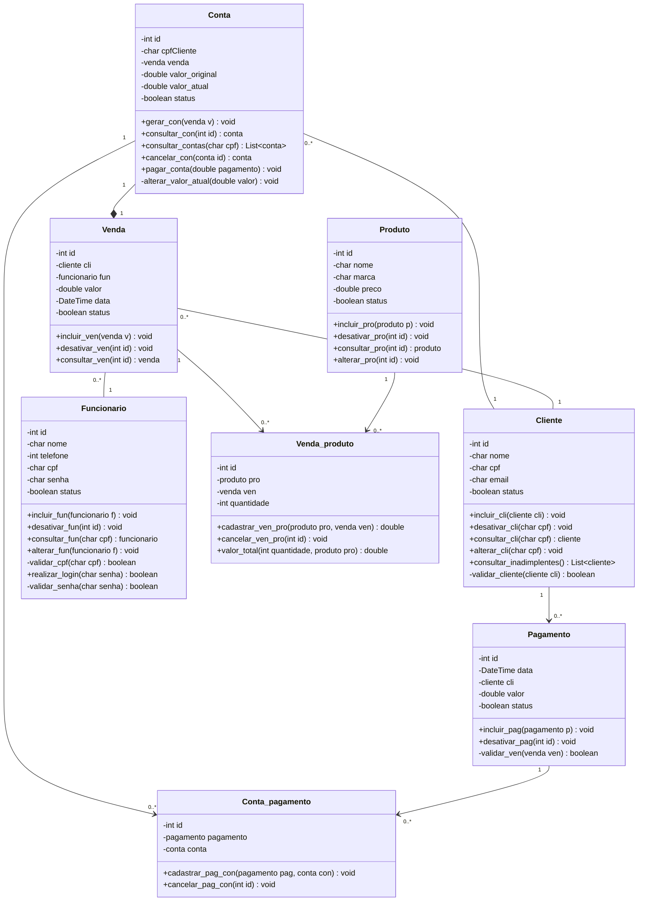
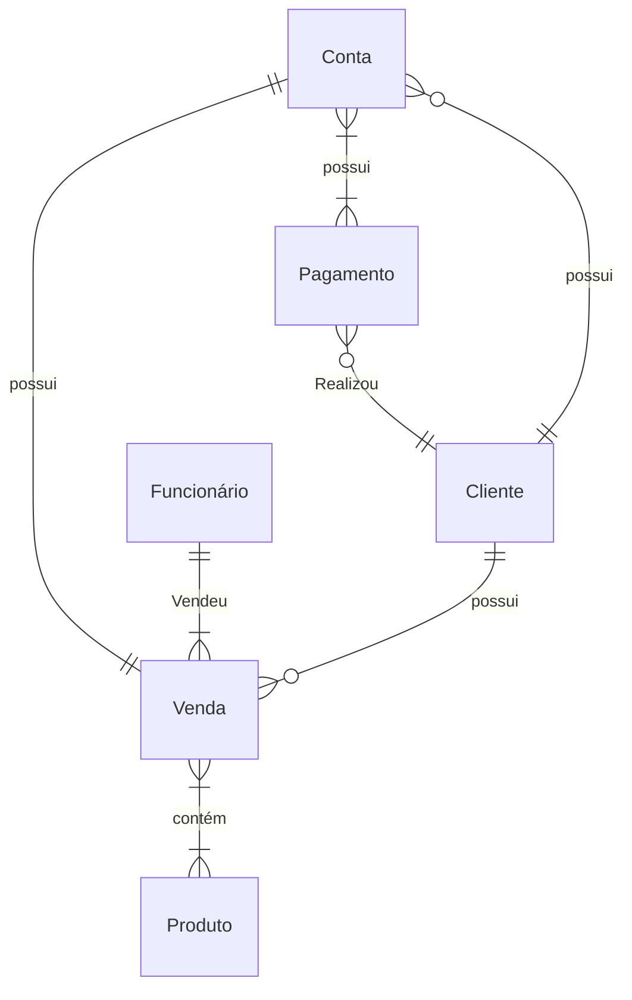

# Documento de Modelos

## Modelo Conceitual

### Diagrama de Classes usando Mermaid

### Descrição das Entidades

| Entidade        | Descrição                                                                                                                                                                                                                                                                                                                                                                                |
| --------------- | ---------------------------------------------------------------------------------------------------------------------------------------------------------------------------------------------------------------------------------------------------------------------------------------------------------------------------------------------------------------------------------------- |
| Conta           | Entidade que representa a dívida do cliente, gerada automaticamente a partir de uma venda. Possui as informações: id, cpfCliente, venda, valor_original, valor_atual, status. Operações: gerar_con(), consultar_con(), consultar_contas(), cancelar_con(), pagar_conta(), alterar_valor_atual(). O pagamento sempre abate a conta ativa mais antiga e o excedente é aplicado na próxima. |
| Conta_pagamento | Entidade associativa que relaciona uma Conta a um Pagamento, registrando quais pagamentos foram aplicados a cada conta. Possui as informações: id, pagamento, conta. Operações: cadastrar_pag_con(), cancelar_pag_con().                                                                                                                                                                 |
| Pagamento       | Entidade que representa um pagamento realizado por um cliente. Possui as informações: id, data, cli, valor, status. Operações: incluir_pag(), desativar_pag(), validar_ven().                                                                                                                                                                                                            |
| Cliente         | Entidade que representa o cliente da loja que compra fiado. Possui as informações: id, nome, cpf, email, status. Operações: incluir_cli(), desativar_cli(), consultar_cli(), alterar_cli(), consultar_inadimplentes(), validar_cliente(). Clientes recém-cadastrados iniciam como "não confiáveis", com limite de crédito de R$ 200.                                                     |
| Venda           | Entidade que representa uma venda fiada realizada por um funcionário para um cliente. Possui as informações: id, cli, fun, valor, data, status. Operações: incluir_ven(), desativar_ven(), consultar_ven(). Cada venda gera uma Conta.                                                                                                                                                   |
| Funcionario     | Entidade que representa o funcionário que opera o sistema e registra as vendas e pagamentos. Possui as informações: id, nome, telefone, cpf, senha, status. Operações: incluir_fun(), desativar_fun(), consultar_fun(), alterar_fun(), validar_cpf(), realizar_login(), validar_senha(). O login é feito apenas com a senha.                                                             |
| Venda_produto   | Entidade associativa que relaciona uma Venda aos Produtos vendidos, com a quantidade de cada um. Possui as informações: id, pro, ven, quantidade. Operações: cadastrar_ven_pro(), cancelar_ven_pro(), valor_total().                                                                                                                                                                     |
| Produto         | Entidade que representa os produtos comercializados pela loja. Possui as informações: id, nome, marca, preco, status. Operações: incluir_pro(), desativar_pro(), consultar_pro(), alterar_pro().                                                                                                                                                                                         |

## Modelo de Dados (Entidade-Relacionamento)

| Nome | Descrição | Tipo de Dado | Tamanho | Restrições de Domínio |
| ---- | --------- | ------------ | ------- | --------------------- |
